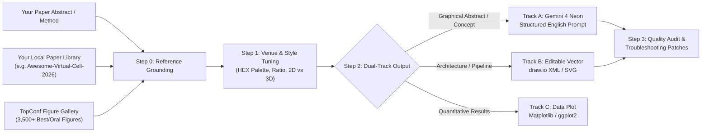

# 🎨 sci-figure-craft

[](LICENSE)
[](#installation)
[](#venue-presets)

> **Reference-Grounded Scientific Figure Design Skill for AI Agents.**  
> Unlike generic "prompt-only" figure generators that hallucinate clichés, `sci-figure-craft` grounds every figure in **your own local library of top-venue benchmark papers**—extracting real Figure 1 layouts, color palettes, and visual hierarchies before generating **Gemini 4 Neon prompts** or **100% editable `draw.io` / `SVG` diagrams**.

---

## 🌟 Why `sci-figure-craft` Is Different

Most AI figure tools ask an LLM to invent a scientific diagram from scratch, which often leads to generic clipart, wrong journal aesthetics, or cluttered layouts.

**`sci-figure-craft` introduces Local Paper Library Grounding:**
1. **Shortlist Real Benchmarks**: The agent scans your local domain paper library (e.g., your Zotero folder or a curated repo like [Awesome-Virtual-Cell-2026](https://github.com/zwYang2004/Awesome-Virtual-Cell-2026)) and picks 2–3 top papers matching your topic and target venue.
2. **Extract & Visually Inspect Figure 1**: Using the bundled `scripts/extract_paper_figures.py`, the agent renders Figure 1 / architecture pages to high-res PNGs and dissects their **spatial flow, HEX palette, module hierarchy, and iconography**.
3. **Style-Transfer Generation**: Your paper's abstract/method is mapped onto that proven visual skeleton—outputting either a **Gemini 4 Neon prompt** (for Nature/Cell/Science Graphical Abstracts) or **editable `draw.io` XML / `SVG`** (for NeurIPS/ICML/ICLR architectures).

---

## ✨ Workflow Architecture



---

## 📚 How to Set Up Your Local Paper Library (Core Feature)

To unlock reference-grounded figure generation, set up a local folder of benchmark PDFs in your research domain:

### Step 1: Clone a Curated Library (or Use Your Own)
You can start immediately with a structured domain library such as [Awesome-Virtual-Cell-2026](https://github.com/zwYang2004/Awesome-Virtual-Cell-2026), or organize your own PDFs by topic:

```bash
git clone https://github.com/zwYang2004/Awesome-Virtual-Cell-2026.git ~/Documents/Paper_Library
```

Recommended folder structure (an optional `README.md` index helps the agent shortlist papers even faster):
```text
~/Documents/Paper_Library/
├── README.md                        # Optional topic index & paper notes
├── 01_Perturbation_Dynamics/        # PDFs of benchmark papers
├── 02_Foundation_Models/
├── 03_World_Models/
└── 04_ICLR_NeurIPS_Architectures/
```

### Step 2: Bind Your Local Library to the Skill (Optional)
You can either mention your library path on the fly (`@/path/to/Paper_Library`), **or** hard-wire it into your local copy of `SKILL.md` under **Step 0 → Local Paper Library** so the agent automatically checks it every time:

```markdown
- **Local Paper Library (Default)**:
  - Default path: `/path/to/your/Paper_Library`
```

### Step 3: Enable Automated Figure Rendering
Install `pymupdf` so the agent can render PDF pages into PNGs for visual style extraction:
```bash
pip install pymupdf
python scripts/extract_paper_figures.py /path/to/paper.pdf --pages 1-3 --out ./extracted_figs
```

---

## 📦 Installation

### Option 1: Antigravity / Gemini CLI (Global)
```bash
git clone https://github.com/zwYang2004/sci-figure-craft.git ~/.gemini/config/skills/sci-figure-craft
```

### Option 2: Workspace-Local (Antigravity / Claude Code / Codex)
```bash
git clone https://github.com/zwYang2004/sci-figure-craft.git .agents/skills/sci-figure-craft
```

---

## 💡 Usage Examples

- **Reference-Grounded Style Transfer (Recommended)**:
  > *"Look into my local paper library `@/path/to/Paper_Library`, pick 2 benchmark papers on perturbation modeling, inspect their Figure 1 layout and palette, and generate a matching Gemini 4 Neon prompt for my abstract: ..."*
- **Nature / Cell / Science Graphical Abstract**:
  > *"Use `sci-figure-craft` to generate a Nature Communications Graphical Abstract prompt for Gemini 4 Neon based on this abstract: ..."*
- **NeurIPS / ICML / ICLR Editable Architecture**:
  > *"Use `sci-figure-craft` to design a NeurIPS Method Architecture diagram as editable `draw.io` XML for my method section."*

---

## 📂 Repository Structure

```text
sci-figure-craft/
├── SKILL.md                          # Core agent skill instructions & 4-step workflow
├── README.md                         # Documentation & Local Paper Library setup guide
├── LICENSE                           # MIT License
├── .gitignore                        # Standard ignore rules
├── scripts/
│   └── extract_paper_figures.py      # Render PDF pages (e.g., Fig 1) to high-res PNGs
└── references/
    ├── style_presets.md              # HEX palettes, ratios & rules by target venue
    ├── few_shot_prompts.md           # Gold-standard prompts (Nature, NeurIPS, IEEE)
    └── troubleshooting.md            # Prompt patches for common AI generation issues
```

---

## 📄 License

MIT License — see [LICENSE](LICENSE) for details.
