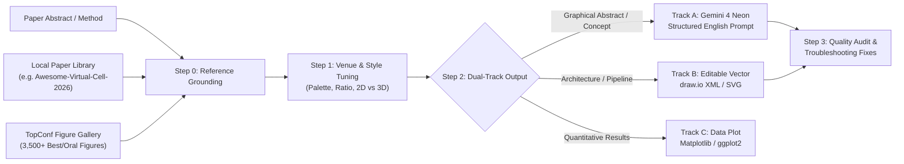

# 🎨 sci-figure-craft

[](LICENSE)
[](#installation)
[](#venue-presets)

> **Publication-grade scientific figure design skill for AI Agents.**  
> Turn paper abstracts & methods into **Nature / Cell / Science** Graphical Abstracts or **NeurIPS / ICML / ICLR** Method Architectures via reference grounding, venue-aware style tuning, and dual-track output (Gemini 4 Neon Prompts + Editable `draw.io` / `SVG`).

---

## ✨ Workflow Architecture



---

## 🚀 Key Features

- **🎯 Venue-Aware Style Presets (`references/style_presets.md`)**: Pre-calibrated visual rules (exact HEX palettes, aspect ratios, typography, 2D schematic vs. subtle 3D isometric) for **NeurIPS / ICML / ICLR / CVPR**, **Nature / NC / NCS / Cell / Science**, and **IEEE / Elsevier**.
- **📚 Local Paper Library Grounding (`scripts/extract_paper_figures.py`)**: Pair with a curated local PDF library—such as [Awesome-Virtual-Cell-2026](https://github.com/zwYang2004/Awesome-Virtual-Cell-2026)—or your own Zotero folder. Automatically shortlist benchmark papers, render Figure 1 pages to high-res PNGs, inspect their visual skeleton, and transfer the style to your paper.
- **🖼️ Online Top-Conference Gallery Integration**: Seamlessly leverages [TopConf Paper Figure Gallery](https://qwdwqfwq.github.io/topconf-paper-figure-gallery/) and its [Forge editor](https://qwdwqfwq.github.io/topconf-paper-figure-gallery/forge/) for editable PPTX/SVG layout inspiration.
- **🔀 Dual-Track Generation**:
  - **Track A (AI Image Prompting)**: Outputs copy-paste-ready 4-part English prompts optimized for **Gemini 4 Neon** with strict text-density control to prevent garbled labels.
  - **Track B (100% Editable Vector)**: Outputs valid `draw.io` XML or standalone `SVG` for zero-typo math notation and pixel-aligned conference diagrams.
- **🛠️ Troubleshooting Playbook (`references/troubleshooting.md`)**: One-line prompt patches for garbled text, cluttered layouts, overly cartoonish styles, or weak visual hierarchy.

---

## 📦 Installation

### Option 1: Antigravity / Gemini CLI (Global)
```bash
git clone https://github.com/zwYang2004/sci-figure-craft.git ~/.gemini/config/skills/sci-figure-craft
```

### Option 2: Workspace-Local (Antigravity / Claude Code / Codex)
```bash
git clone https://github.com/zwYang2004/sci-figure-craft.git .agents/skills/sci-figure-craft
```

### Optional: Python Helper for PDF Figure Extraction
If you want the agent to automatically render pages from local PDF papers into PNGs for visual style extraction:
```bash
pip install pymupdf
python scripts/extract_paper_figures.py path/to/paper.pdf --pages 1-3 --out ./extracted_figs
```

---

## 💡 Usage Examples

- **Nature Sub-journal Graphical Abstract**:
  > *"Use `sci-figure-craft` to generate a Nature Communications Graphical Abstract prompt for Gemini 4 Neon based on this abstract: ..."*
- **NeurIPS / ICLR Editable Architecture**:
  > *"Use `sci-figure-craft` to design a NeurIPS Method Architecture diagram as editable `draw.io` XML for my method section."*
- **Style Transfer from Local Paper Library**:
  > *"Look into my local paper library `@/path/to/Awesome-Virtual-Cell-2026`, pick 2 benchmark papers on perturbation modeling, inspect their Figure 1 style, and generate a matching prompt for my paper."*

---

## 📂 Repository Structure

```text
sci-figure-craft/
├── SKILL.md                          # Core agent skill instructions & 4-step workflow
├── README.md                         # Project documentation
├── LICENSE                           # MIT License
├── .gitignore                        # Standard ignore rules
├── scripts/
│   └── extract_paper_figures.py      # Render PDF pages (e.g., Fig 1) to high-res PNGs
└── references/
    ├── style_presets.md              # HEX palettes, ratios & rules by target venue
    ├── few_shot_prompts.md           # Gold-standard prompts (Nature, NeurIPS, IEEE)
    └── troubleshooting.md            # Prompt patches for common AI generation issues
```

---

## 📄 License

MIT License — see [LICENSE](LICENSE) for details.
